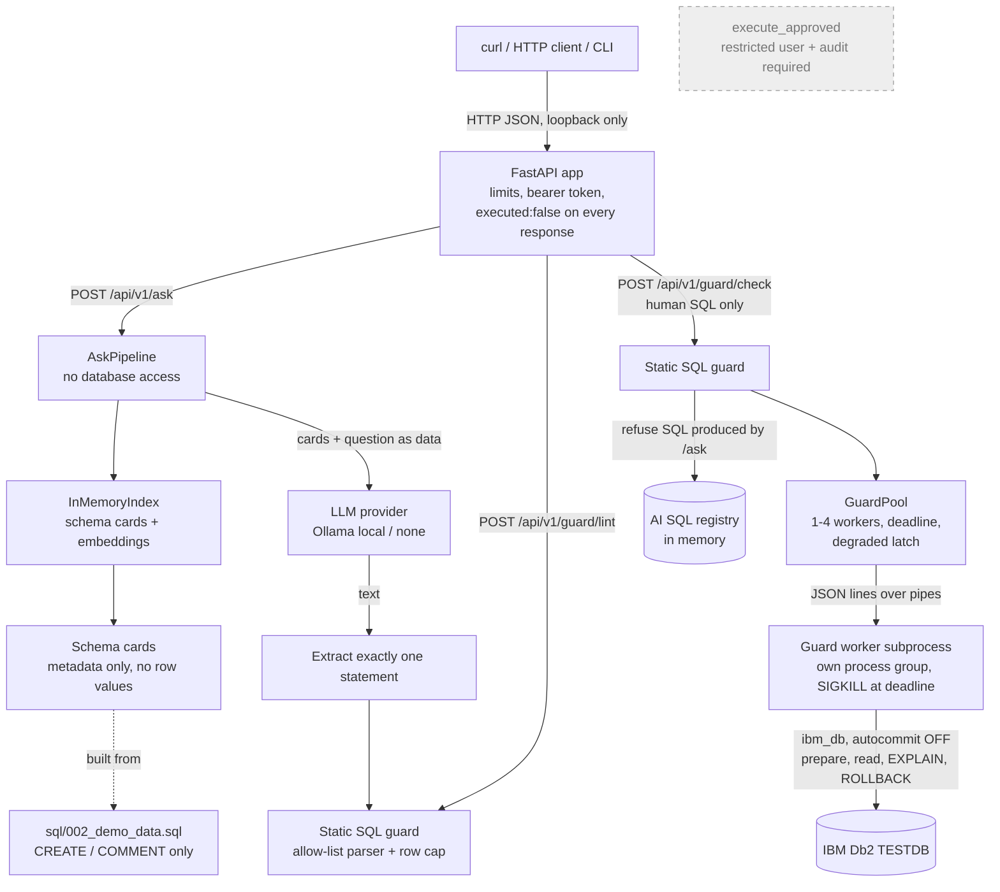

# System Architecture

## Overview
Db2 Intelligence turns business questions into IBM Db2 SQL and decides, before anything runs,
whether that SQL is safe: one read-only statement, only allowed schemas, a row cap, and an
acceptable Db2 cost estimate and access plan. The system is built so that generating SQL and
trusting SQL are separate steps:

- The **LLM side** (schema retrieval, prompt, model, extraction) never talks to Db2.
- The **guard side** talks to Db2 only to *prepare* and *explain* human-written SQL, inside a
  separate worker process with a hard deadline; it always rolls back and proves its explain rows
  are gone.
- **Nothing executes SQL.** Execution code exists but no route or command reaches it, and it is
  blocked until a restricted Db2 user and audit persistence exist. Audit writes are disabled.

Current status (what has been verified on Db2 versus with fakes) is listed in the README under
*Project Status*.

---

## Architecture Diagram



The dashed `execute_approved` component exists in code but is unreachable: no route or CLI
command calls it, and it refuses to run without a restricted principal and a ready audit sink
(the configured sink is `DisabledAuditSink`).

---

## Component Breakdown

1. **Client layer**
   - Command line: `python -m db2intel.db.migrate` (migrations), `python -m db2intel.guard lint|check`
     (SQL guard), `python -m db2intel.api` (HTTP server). There is no web UI yet.
2. **API layer** (`src/db2intel/api/`)
   - Five routes: `GET /health`, `GET /api/v1/guard/status`, `POST /api/v1/guard/lint`,
     `POST /api/v1/guard/check`, `POST /api/v1/ask`. The app refuses to start if the route set
     differs from this list.
   - Binds to a loopback address only; bearer token for `/api/*` (without one the guard pool is
     not created and `/guard/check` answers 503 `guard_disabled`); request bodies limited
     by actual bytes received; unknown request fields rejected; validation errors never echo input;
     Db2 driver messages reduced to SQL code and SQLSTATE; interactive docs disabled.
   - Every response body has `"executed": false`; every response has `X-Db2Intel-Executed: false`.
3. **SQL guard** (`src/db2intel/guard/`)
   - `lexer.py`, `parser.py`, `rules.py`: allow-list static analysis of exactly one `SELECT`/`WITH`.
     Rejects comments, multiple statements, data-change table references, locking and isolation
     clauses, parameter markers and host variables, recursive CTEs, table functions, unqualified
     tables, denied schemas (`DB2INST1`, `DB2INTEL`, `SYS*`, ...) and functions outside the
     allow-list; appends or lowers `FETCH FIRST n ROWS ONLY`.
   - `context.py`: read-only preflight against Db2 (server, statement concentrator off, explain
     tables present, limits, enabled data sources, no UDF shadowing allow-listed built-ins).
   - `analysis.py`: prepare-only analysis (package cache, cost, `EXPLAIN_FROM_SECTION`, plan object
     checks, rollback, leftover verification).
   - `worker.py`: `GuardPool` and worker subprocesses (see *Data Flow*).
   - `execution.py`, `audit.py`: gated execution path and audit records; not reachable.
4. **AI / retrieval layer** (`src/db2intel/nl2sql/`, `src/db2intel/rag/`, `src/db2intel/ai/`)
   - `rag/catalog.py`: table metadata from DDL text (offline) or from `SYSCAT.TABLES`, `COLUMNS`,
     `KEYCOLUSE`/`TABCONST` and `REFERENCES` (read-only; not wired in yet).
   - `rag/cards.py`: schema cards (names, declared types, nullability, keys, cleaned remarks).
     `CHECK` constraints, defaults, generated expressions and row values are never included.
   - `rag/index.py`: in-memory cosine-similarity index, filtered by data-source schema.
   - `ai/embeddings.py`: Ollama `nomic-embed-text` (768 dimensions) or a deterministic offline
     embedder; vectors are validated against the `VECTOR(768, FLOAT32)` column size.
   - `nl2sql/llm.py`: `NoLLM`, `OllamaLLM` (local `/api/chat`, temperature 0), `StaticLLM` (tests).
   - `nl2sql/prompt.py`, `extract.py`, `pipeline.py`: prompt with fenced data sections, strict
     single-statement extraction, static guard, result `LINT_APPROVED` / `BLOCKED` / `NO_SQL`.
5. **Database layer (IBM Db2)** — see *IBM Db2 Schema & Storage Design*.

---

## Data Flow

### Natural-language question (`POST /api/v1/ask`) — no database access
1. **Input:** question (max 2,000 characters, no control characters, no reserved marker) and data
   source (`demo`).
2. **Context retrieval:** the question is embedded and compared with the schema-card embeddings;
   the top cards for the data source's schemas are selected.
3. **Augmentation & inference:** the cards and the question are placed between fixed delimiters
   as data; the model is asked for one fenced SQL block.
4. **Validation:** exactly one statement is extracted and checked by the static guard. The canonical
   SQL is recorded in an in-memory registry so `/guard/check` can refuse it.
5. **Response:** SQL text, guard decision, retrieved objects, `executed: false`,
   `db_checked: false`. Nothing is written anywhere.

### Guard check of human-written SQL (`POST /api/v1/guard/check`)
1. Static guard (no database). Blocked SQL never reaches a worker.
2. SQL produced by `/ask` in this process is refused (HTTP 403) — Db2 analysis of AI-generated SQL
   is not enabled yet.
3. The pool waits briefly for a free worker (otherwise HTTP 503 `busy`). Each worker is a
   subprocess in its own process group with its own Db2 connection (autocommit off) and an
   allow-listed environment (no API token, LLM settings or API keys; only allow-listed `.env` keys).
   On startup a worker runs the read-only preflight and counts the rows in all 11 explain tables;
   if any is non-empty it refuses to start and the pool becomes degraded. Worker stderr goes to a
   redacted, size-bounded log file (`DB2INTEL_WORKER_LOG`).
4. In the worker: request marker added → `PREPARE` (deferred prepare off) → one package-cache entry
   with that marker, exact text, zero executions → cost limit → `EXPLAIN_FROM_SECTION` → explain rows
   located by marker and read by the full explain key → every table and index in the plan must be
   in an allowed schema → cache entry re-checked → `ROLLBACK` → leftover explain rows counted.
5. The decision (`APPROVED`, `BLOCKED`, `COST_REJECTED` or `ERROR`) is validated by the parent and
   returned with cost, plan objects and operators. Nothing is executed or committed.
6. If the worker misses its deadline, the whole process group is killed with SIGKILL (Db2 rolls back
   the dropped connection). A kill, a crash, a malformed reply, a `cleanup_failed` decision or explain
   rows found at worker startup put the pool into a **degraded** state: all later checks are refused until restart. Nothing is cleaned
   up automatically.

### Shutdown
On Ctrl+C or SIGTERM, uvicorn finishes in-flight requests and runs the FastAPI lifespan shutdown,
which calls `shutdown_app()` once (guarded by an atomic once-only lock; `main()` calls it again as a
fallback, which is then a no-op). `GuardPool.close()` is idempotent: idle workers get EOF and are
reaped; workers still inside a check are SIGKILLed with their process group and reaped; a worker
that finishes starting after the close is killed. uvicorn then re-raises the signal, so the
process exits with the signal status.

### State persistence
None at runtime. Migrations are the only writes, run explicitly by an operator. `QUERY_AUDIT`
writes are disabled until audit persistence is approved.

---

## IBM Db2 Schema & Storage Design

Created by `sql/001_schema_meta.sql`, `sql/002_demo_data.sql` and `sql/003_explain_tables.sql`
(each applied in one transaction and recorded with its SHA-256 checksum). Abridged:

```sql
-- Application metadata (schema DB2INTEL), excerpt from sql/001_schema_meta.sql
CREATE TABLE DB2INTEL.DATA_SOURCE (
    SOURCE_ID      INTEGER       NOT NULL GENERATED ALWAYS AS IDENTITY (START WITH 1 INCREMENT BY 1),
    SOURCE_NAME    VARCHAR(64)   NOT NULL,
    DATABASE_NAME  VARCHAR(8)    NOT NULL,
    SCHEMA_NAME    VARCHAR(128)  NOT NULL,
    ACCESS_MODE    VARCHAR(10)   NOT NULL DEFAULT 'READ_ONLY',
    IS_ENABLED     SMALLINT      NOT NULL DEFAULT 1,
    DESCRIPTION    VARCHAR(254),
    CREATED_AT     TIMESTAMP     NOT NULL DEFAULT CURRENT TIMESTAMP,
    CONSTRAINT PK_DATA_SOURCE PRIMARY KEY (SOURCE_ID),
    CONSTRAINT UQ_DATA_SOURCE_NAME UNIQUE (SOURCE_NAME),
    CONSTRAINT UQ_DATA_SOURCE_TARGET UNIQUE (DATABASE_NAME, SCHEMA_NAME),
    CONSTRAINT CK_DATA_SOURCE_MODE CHECK (ACCESS_MODE = 'READ_ONLY'),
    CONSTRAINT CK_DATA_SOURCE_ENABLED CHECK (IS_ENABLED IN (0, 1)),
    CONSTRAINT CK_DATA_SOURCE_PROTECTED CHECK (NOT (DATABASE_NAME = 'TESTDB' AND SCHEMA_NAME = 'DB2INST1'))
);

-- One native Db2 VECTOR per (schema object, embedding model). Planned search:
-- VECTOR_DISTANCE(EMBEDDING, VECTOR(?, 768, FLOAT32), COSINE)  [not implemented yet]
CREATE TABLE DB2INTEL.SCHEMA_EMBEDDING (
    OBJECT_ID        BIGINT        NOT NULL,
    EMBEDDING_MODEL  VARCHAR(64)   NOT NULL,
    CONTENT_SHA256   CHAR(64)      NOT NULL,
    EMBEDDING        VECTOR(768, FLOAT32) NOT NULL,
    CREATED_AT       TIMESTAMP     NOT NULL DEFAULT CURRENT TIMESTAMP,
    CONSTRAINT PK_SCHEMA_EMBEDDING PRIMARY KEY (OBJECT_ID, EMBEDDING_MODEL),
    CONSTRAINT FK_SCHEMA_EMBEDDING_OBJ FOREIGN KEY (OBJECT_ID)
        REFERENCES DB2INTEL.SCHEMA_OBJECT (OBJECT_ID) ON DELETE CASCADE
);
```

| Schema | Objects | Purpose |
|---|---|---|
| `DB2INTEL` | `SCHEMA_MIGRATION` | Migration ledger with checksums |
| | `APP_SETTING` | `query.max_rows` (500), `query.max_estimated_cost` (50,000 timerons), `query.timeout_seconds` (30), retrieval settings |
| | `DATA_SOURCE` | Read-only data sources; the guard reads only enabled ones |
| | `SCHEMA_OBJECT`, `SCHEMA_EMBEDDING` | Schema objects and their `VECTOR(768, FLOAT32)` embeddings (empty; indexer not yet approved) |
| | `VERIFIED_QUERY`, `VERIFIED_QUERY_EMBEDDING` | Reviewed question/SQL pairs with vectors (empty) |
| | `QUERY_AUDIT`, `QUERY_FEEDBACK` | Audit and feedback (writes disabled) |
| | 11 explain tables | Targets of `EXPLAIN_FROM_SECTION`; always empty after every check |
| `DB2INTEL_DEMO` | `REGION`, `PRODUCT`, `CUSTOMER`, `SALES_ORDER`, `ORDER_ITEM`, `V_ORDER_SUMMARY` | Synthetic sales data with keys, checks, indexes and catalog remarks |

Key Db2 statements used by the guard (all reads, plus the explain procedure whose rows are rolled
back):

```sql
SELECT HEX(EXECUTABLE_ID), QUERY_COST_ESTIMATE, NUM_EXECUTIONS, STMT_TEXT
FROM TABLE(MON_GET_PKG_CACHE_STMT('D', NULL, NULL, -2)) AS T
WHERE STMT_TEXT LIKE ? ESCAPE '!';

-- via ibm_db.callproc; the executable id comes from the package-cache lookup above
CALL SYSPROC.EXPLAIN_FROM_SECTION(?, 'M', NULL, -1, 'DB2INTEL', ?, ?, ?, ?, ?);

SELECT RTRIM(OBJECT_SCHEMA), RTRIM(OBJECT_NAME), RTRIM(OBJECT_TYPE), EXPLAIN_LEVEL, STMTNO, SECTNO
FROM DB2INTEL.EXPLAIN_OBJECT
WHERE EXPLAIN_REQUESTER = ? AND EXPLAIN_TIME = ? AND SOURCE_NAME = ? AND SOURCE_SCHEMA = ? AND SOURCE_VERSION = ?;
```

---

## Security & Secrets Management
- Database credentials are read only from a git-ignored `.env` (or the environment); messages name
  settings but never print the password; driver errors are redacted.
- Existing database objects are protected: `DB2INST1` (including `EMPLOYEE_INFO` and
  `EMPLOYEE_SALARY`) is a hard-denied schema for the guard, a `CHECK` constraint forbids registering
  it as a data source, and migrations only create objects in `DB2INTEL` and `DB2INTEL_DEMO`.
- `SAMPLE` is refused by the migration runner and the guard preflight; migrations and guard
  checks connect only to allow-listed local hosts and databases.
- Read-only connection flags and rollback are **not** treated as security boundaries; the boundary
  for future execution is a dedicated Db2 user with `CONNECT` and `SELECT` on the demo schema only.
- The API binds to loopback only, limits request sizes and never returns raw driver messages. The
  guard pool, which prepares and explains against Db2, is only created when a bearer token is
  configured, so no unauthenticated local process can trigger Db2 work.
- Guard workers receive an allow-listed environment and read only allow-listed `.env` keys, so the
  API token and LLM/API keys never reach the process that holds the Db2 connection. Their stderr
  is redacted and size-bounded before it is written to a git-ignored `*.log` file (mode 0600). The LLM server must be local unless explicitly allowed, because prompts
  contain schema descriptions.
- Automated tests check that passwords and tokens never appear in settings reprs, error messages
  or API responses; that no API, NL-to-SQL or retrieval module references the execution path; that
  runtime tripwires on every execute/prepare/connect entry point never fire from any route; and
  that the migration files keep their reviewed checksums. A secret-pattern scan of the submission
  folder is run before each review.
